# ЁжPM

## Диаграмма классов:

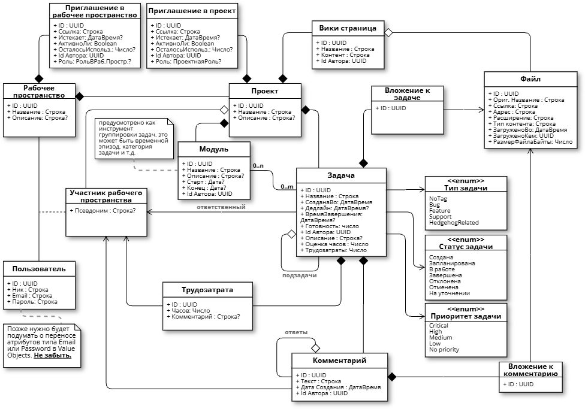

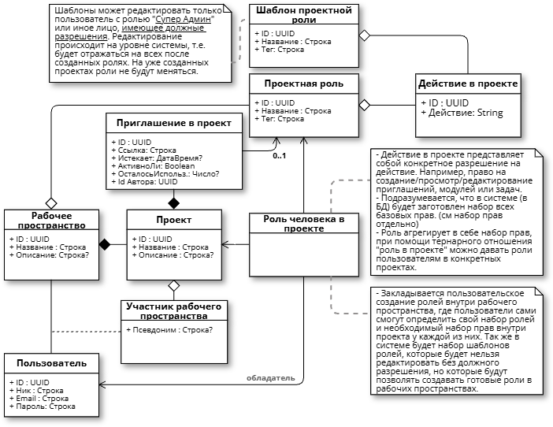

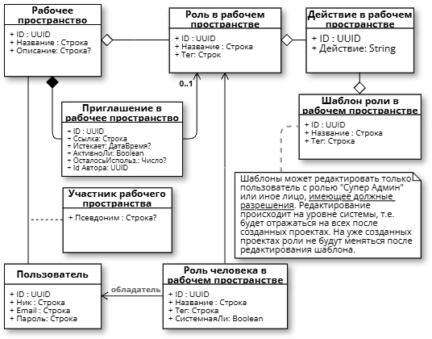

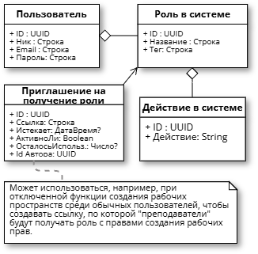

## Схема, представленная для большего понимания ролевой модели. Не претендует на строгую причастность к какой либо нотации, языку или спецификации: 

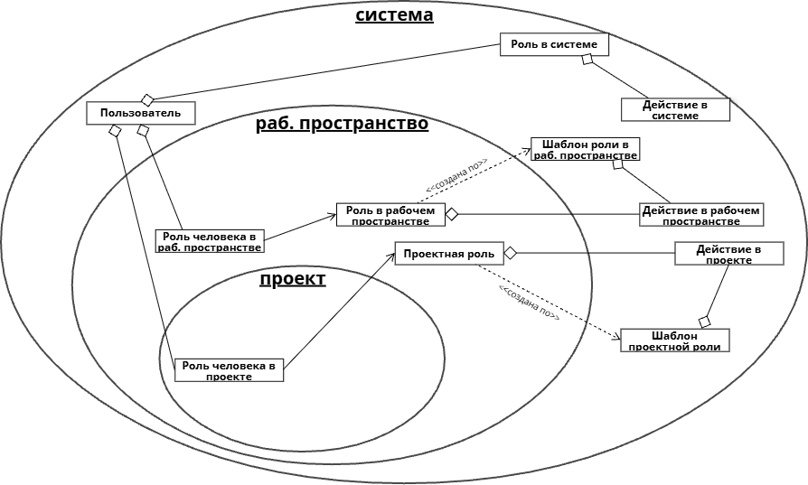

## Permissions table: 

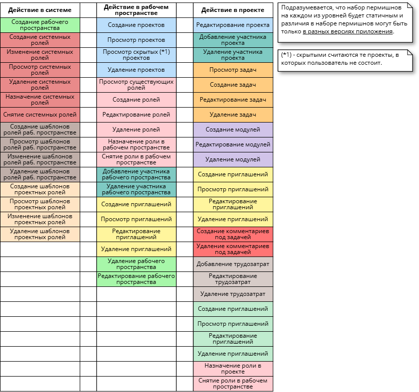

## Диаграммы обьектов:

### Пример структуры рабочего пространства, проектов и задач на примере проектов для стажировок на хитсе:

### Пример структуры рабочего пространства, проектов и задач на примере базового курса по алгоритмике:

### Пример иной формы реализации курсов по алгоритмике на еже:

### Пример простой ролевой модели на примере курса основ прямого проектирования:
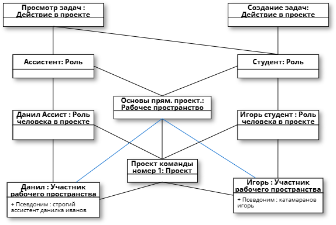

## Варианты использования:

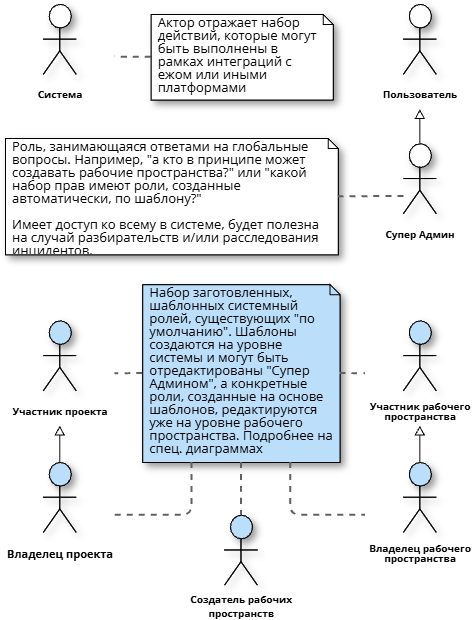

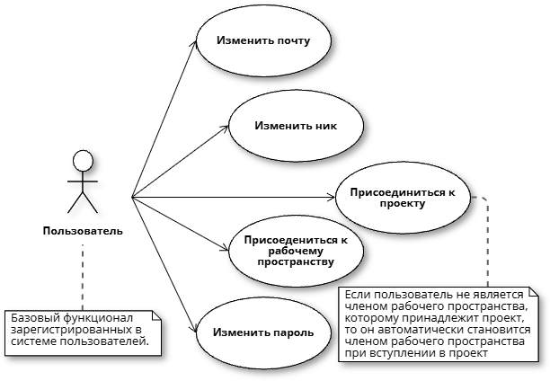

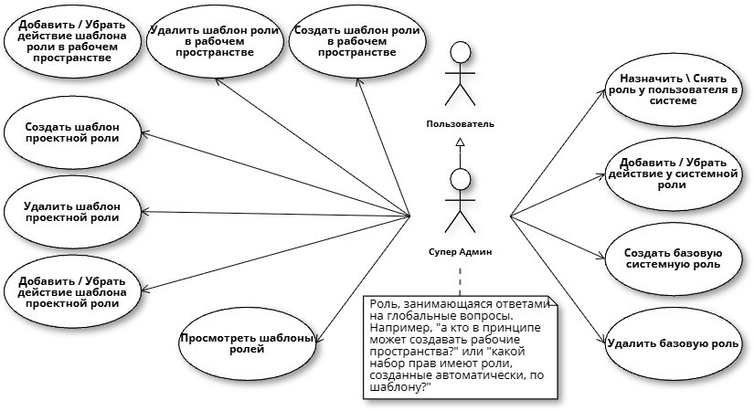

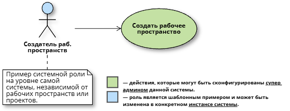

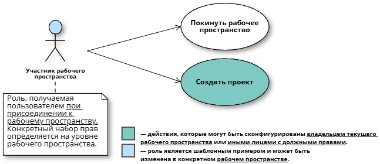

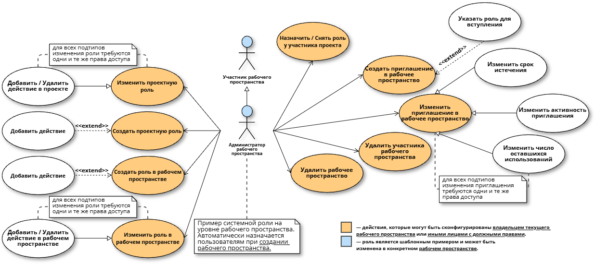

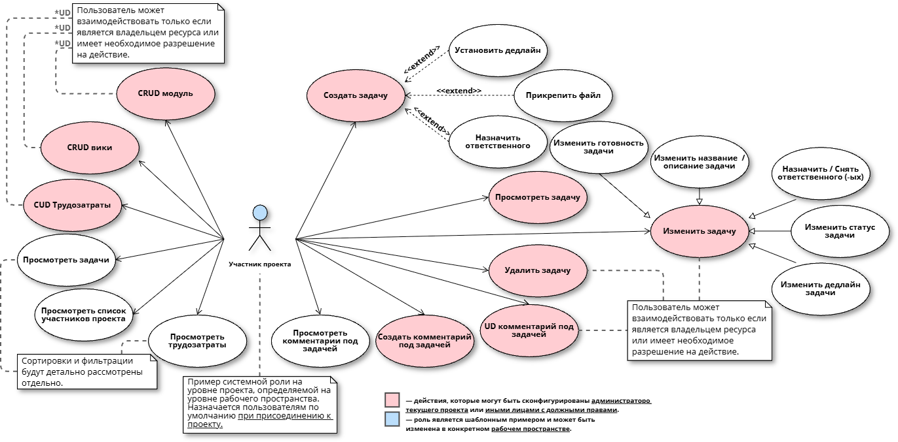

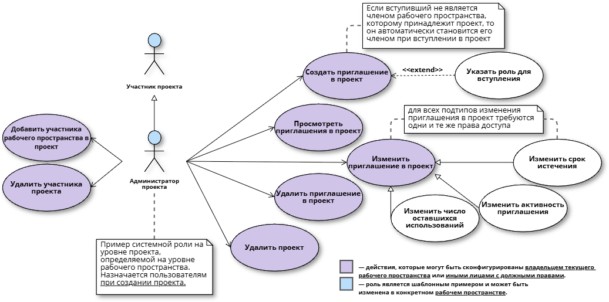

## Рекомендации по разработке: 

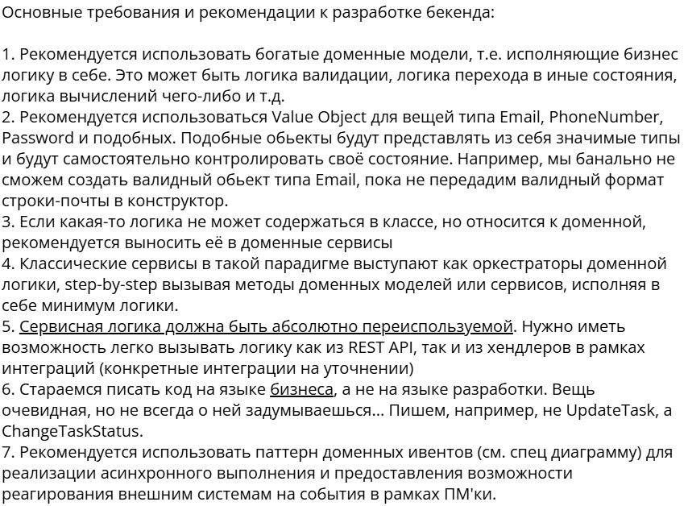

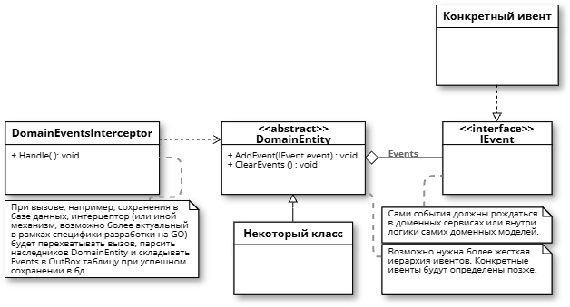

## Набор доступных фильтраций для трудозатрат и задач:

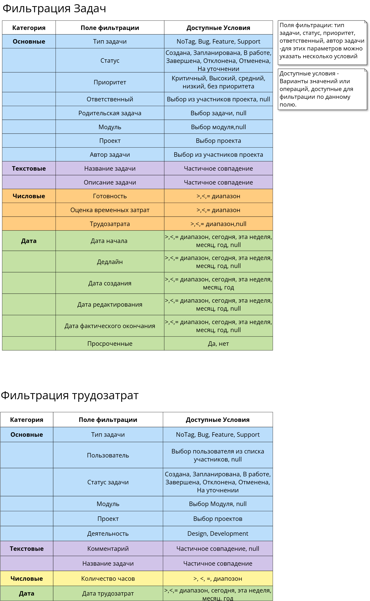
