# ЁжPM

## Диаграмма классов:

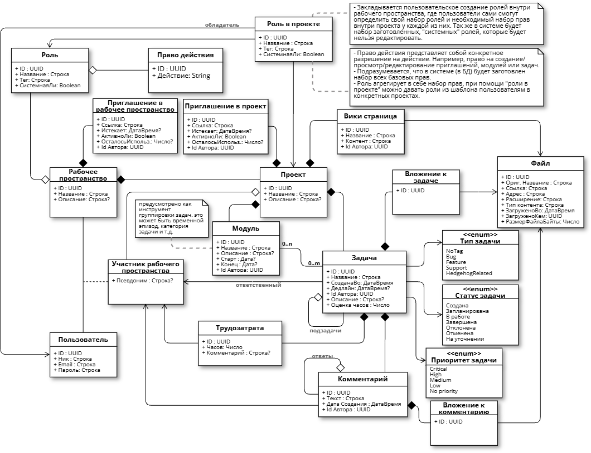

## Диаграммы обьектов:

### Пример структуры рабочего пространства, проектов и задач на примере проектов для стажировок на хитсе:
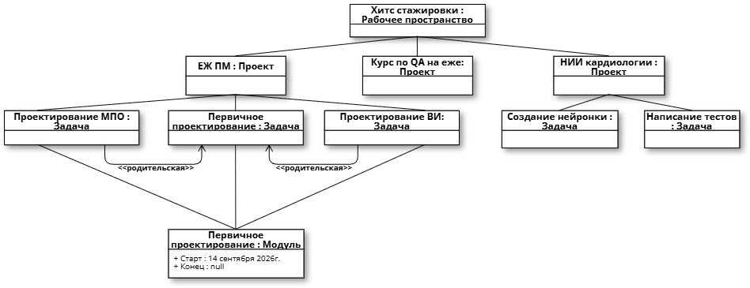

### Пример структуры рабочего пространства, проектов и задач на примере базового курса по алгоритмике:
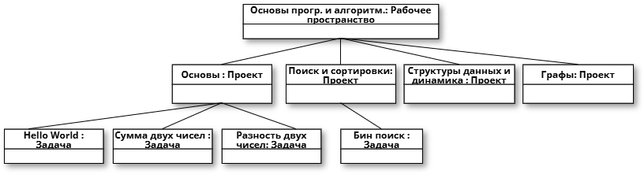

### Пример иной формы реализации курсов по алгоритмике на еже:
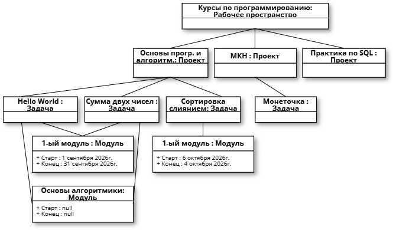

### Пример простой ролевой модели на примере курса основ прямого проектирования:
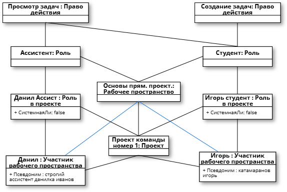

## Матрица прав доступа (Частично неактуальна, сейчас отражает скорее набор потенциально заготовленных в системе ролей "по умолчанию"):

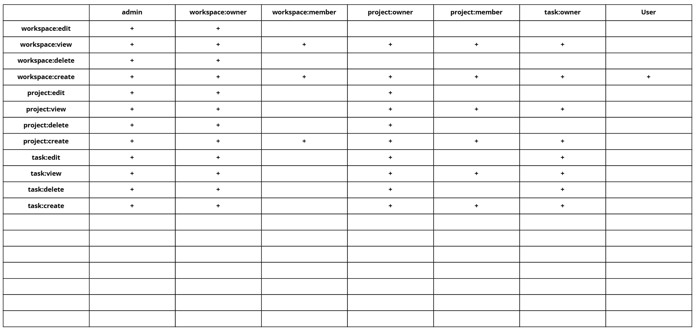

## Use Cases:

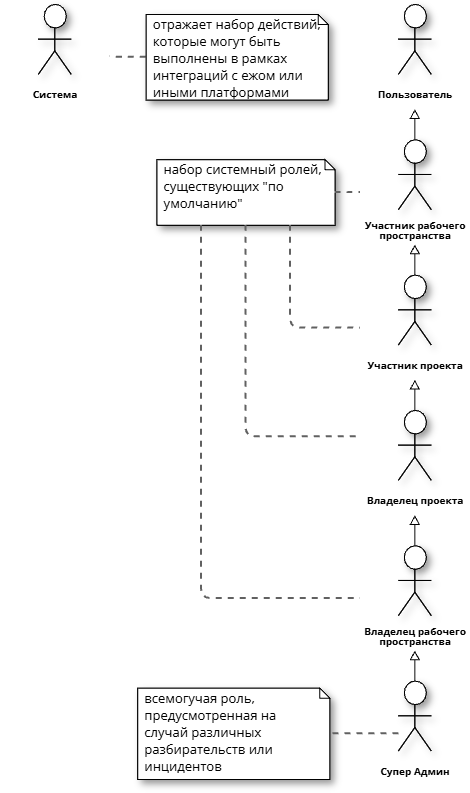

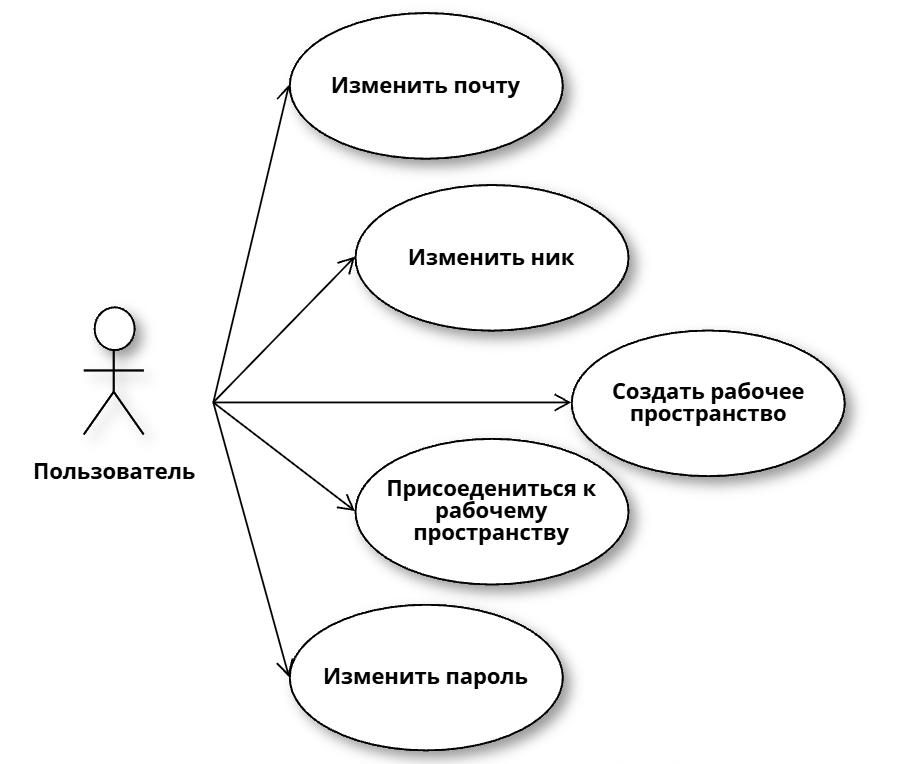

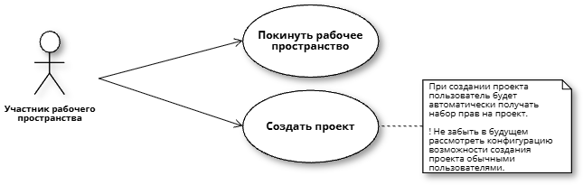

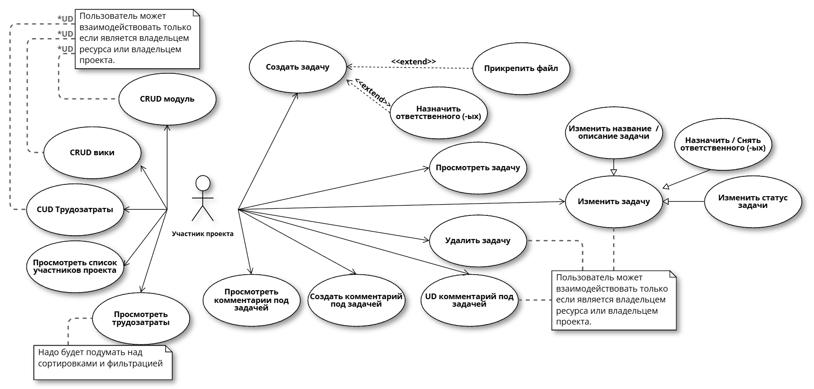

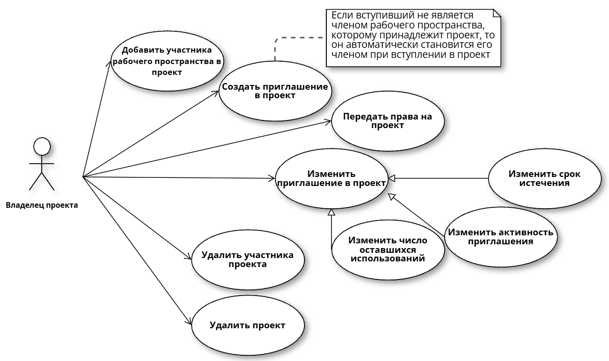

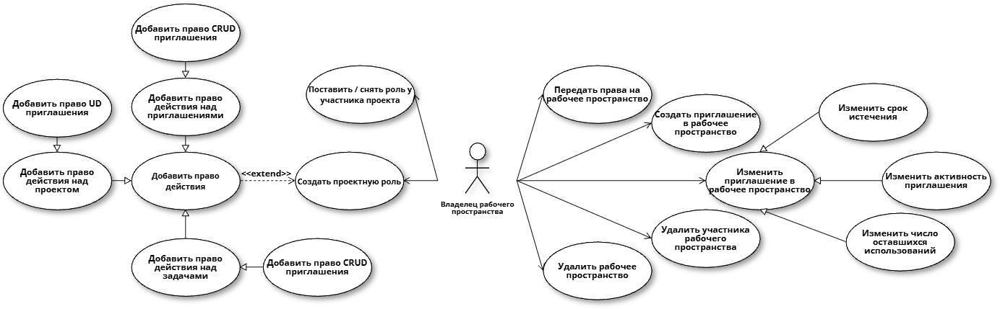

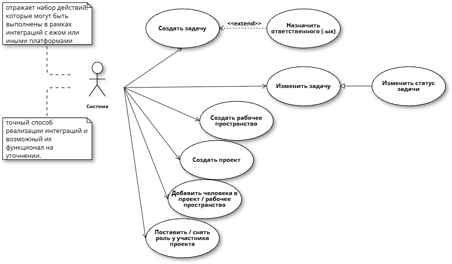